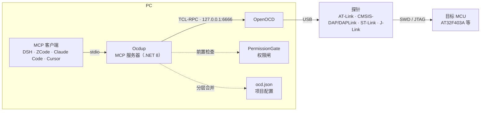

<div align="center">

# 🔧 Ocdup

**PC 侧的 OpenOCD 门面（MCP 服务器）**

让 MCP 客户端（DSH / ZCode / Claude Code / Cursor…）用自然语言驱动硬件调试器：
**连接探针 → 烧录固件 → 读写内存 → 执行控制**，全程无需手敲 TCL。

[](https://github.com/wenliang9527/ocdup/actions/workflows/ci.yml)
[](docs/design-plan.md)
[](plugins/ocdup-zcode/README.md)

</div>

---

## 💡 它能做什么

把调试器变成 AI 的「手」：你说目标，Ocdup 把它翻译成 OpenOCD 的 TCL 命令，
再把结果带上上下文整理成人话返回。典型场景：

| 你说 | AI 实际调用 | 说明 |
|---|---|---|
| 「把 build/fw.hex 烧进板子，烧完跑起来」 | `connect` → `flash_info` → `flash_write` | 自动擦写 + 校验（Verified OK）+ 复位运行 |
| 「板子里现在跑的是什么固件？」 | `verify_image` | 只读比对镜像与 flash 内容，不写任何东西 |
| 「读一下 0x20000000 处的 16 个字」 | `read_memory` | 8/16/32 位宽度；`format=json` 返回结构化值 |
| 「把整片 flash 备份下来」 | `dump_memory` | 大块落盘，返回路径 + 字节数 + sha256 |
| 「板子好像卡死了，看看现场」 | `halt` → 读写现场 → `reset run` | 执行控制；halt 后读写才可靠 |
| 「擦掉 0x080C0000 那个扇区」 | `flash_erase_sector` | 破坏性操作，默认关闭，显式开启才可用 |
| 「跑这条 TCL：`targets`」 | `run_command` | 原始命令逃生舱，兜底专用工具没覆盖的操作 |

## 🧰 工具一览（23 个）

### 会话与诊断

| 工具 | 作用 | 权限 |
|---|---|---|
| `connect` | 连接控制通道；无监听时按 ocd.json 自动拉起 OpenOCD（`interface_cfg: "auto"` 时先识别探针）；成功后 best-effort 自动识别芯片（CPUID + DEV_ID,3s 短超时，目标不应答不拖垮连接）+ flash 布局（`flash probe`+`flash banks`，target 失配时跳过）；identify 与 `target_presets` 不符时回报 `target mismatch` 行 | — |
| `status` | 后端是否运行、版本、target 列表、通道状态（空闲时长 / 自动重连说明；只读，不启动任何东西） | — |
| `show_config` | 有效设置与每项来源（`reload=true` 重读 ocd.json） | — |
| `backend_log` | ocdup 自己拉起的 openocd 近期 stdout/stderr（异步 `Info:` / `Error:` 日志从这里出） | 只读 |
| `identify_chip` | **连上后确认芯片**：读 CPUID（0xE000ED00，ARM 内核标准）+ 厂商 ID 寄存器（默认 0xE0042000），DEV_ID 按 ocd.json 的 `chip_id_map` 给出家族；家族与当前 `target_cfg` 不符时附失配行 | 只读 |
| `set_target` | **换芯片不重启会话**：按 ocd.json 的 `target_presets` 注册表切 target_cfg 并重启后端（target 是启动参数，必须重启；只重启 ocdup 自拉的实例；起不来自动回滚） | `read_only` |
| `set_permissions` | **运行时改权限**（免改 ocd.json；闸 = ocd.json 的 `allow_set_permissions`，默认关；reload/重启丢弃） | 自身的授权闸 |

### 烧录

| 工具 | 作用 | 权限 |
|---|---|---|
| `flash_info` | 列出 flash banks（驱动、基址、大小） | 只读 |
| `flash_write` | **下载**：烧录镜像（写 → 独立读回校验判据 → 可选复位运行；结论三段式：verified / verify FAILED / write failed）；执行期 openocd 日志行以 progress notification 推回带 progressToken 的调用方 | `read_only` / `allow_flash` / 白名单 / 上限 |
| `verify_image` | **烧后独立校验**：镜像与目标 flash 比对，不写任何东西（回答「板子里到底是谁」） | 只读 |
| `flash_erase_sector` | 擦除 flash 扇区（破坏性，默认关闭） | `read_only` / **`allow_flash_erase`（默认 false）** |

### 内存读写

| 工具 | 作用 | 权限 |
|---|---|---|
| `read_memory` | **读指定地址**：按 8/16/32 位宽度读回；`format=json` 返回结构化值（免解析 OpenOCD 文本） | 只读 + 体积上限 |
| `dump_memory` | **大块读落盘**：整片 flash / RAM 快照存成文件，返回 sha256 + 前 64 字节 | 目标侧只读；PC 侧落盘受 `dump_allowed_paths`（默认 `dumps/`）+ `dump_max_bytes`（默认 64 MB）约束 |
| `write_memory` | 写内存/寄存器（一条命令写多个值） | `read_only` / `allow_memory_write` |

### 执行控制与逃生舱

| 工具 | 作用 | 权限 |
|---|---|---|
| `halt` / `resume` / `reset` | 执行控制：halt 后读写才可靠，并带回核心寄存器现场（pc/lr/sp/xpsr，「跑飞在哪」一步定位）；reset run 重启固件 | `read_only` / **`allow_exec`（默认 true）** |
| `run_command` | 原始 TCL 逃生舱（单行命令，兜底专用工具没覆盖的操作）；写类命令带内容分类（RawCommandPolicy）：`program`/`dump_image`/`shutdown` 等重定向专用工具，`erase`/`fill`/`mww`/`reset` 等走对应专用闸 | `read_only` / `allow_raw_command`（默认 false） |
| `disconnect` | 断开 ocdup 自拉的后端并释放探针（让给别的 agent 软件；幂等；端口上是外部实例时杀不动会如实说明）；read_only 会话拦截 | `read_only` |

### 符号层（L1，按变量名读写）

| 工具 | 作用 | 权限 |
|---|---|---|
| `list_variables` | 列出 .elf 里的变量（地址/大小/名，可 pattern 过滤）——PC 侧读文件，不动目标 | — |
| `read_variable` | 按名读变量（ELF 定位 → 目标读回；受 `memory_read_max_bytes` 约束） | 只读 |
| `write_variable` | 按名写 1/2/4 字节变量（大对象走 `write_memory`） | `read_only` / `allow_memory_write` |

> 用法：`ocd.json` 里把 `elf_path` 指到编译产物（未 strip 的 .elf），三个工具就都有默认镜像了。

### 符号层（L2，按名读写外设寄存器，v0.4.21）

| 工具 | 作用 | 权限 |
|---|---|---|
| `load_svd` | 加载 CMSIS-SVD 文件（自研 XML 解析，支持 cluster 展平与三种位域写法），列外设/寄存器清单——PC 侧读文件，不动目标 | — |
| `read_peripheral_register` | **按名读寄存器**（`"RCC.CR"`、簇寄存器 `"TIM1.PWM.CCR"`）：地址从 SVD 解出，读回带位域解码 + reset 比对；`svd_path` 可作默认镜像 | 只读 |
| `write_peripheral_register` | 按名写寄存器：值按寄存器宽度掩码；SVD access 为 read-only 的寄存器即使权限放行也拒写 | `read_only` / `allow_memory_write` |

### ⏱ watch CLI（M-watch，v0.4.3）

盯变量曲线/调参用**子命令 CLI**（长时运行不占 MCP 串行通道），配置与后端复用 `ocd.json`：

```bash
ocdup watch --name gCounter --name flag          # 默认 250ms 一拍,人读格式,Ctrl+C 结束
ocdup watch --name gCounter --format csv --interval 100 > log.csv   # 重定向画曲线
ocdup watch --name adc --halt                    # 每拍暂停固件读一致快照(过 allow_exec 闸)
ocdup watch --help                               # 全部选项
```

### 🩺 doctor CLI（P1-6，v0.4.15）

换机 / 上手排障第一步——把四步外部依赖拼成一张 [OK]/[WARN]/[FAIL] + 如何修的体检单
（只读：不拉起 openocd、不碰目标；端口已有监听时只做一次只读 version 查询；有 FAIL 退出码 1，可进 CI）：

```bash
ocdup doctor    # 检查 ocd.json / OCD_BIN(--version 实跑) / OCD_SCRIPTS / 探针 / 后端端口
```

### 📡 rtt CLI（SEGGER RTT 实时读取，v0.4.19）

读固件 printf / 自定义日志流**子命令 CLI**（同 watch：长时连续流不占 MCP 串行通道）。
命令面按本机 atopenocd-py32 实测定案（fork 无 `rtt terminal`，数据走 `rtt server` 的本机 TCP 端口）；
原始字节直通 stdout（二进制协议安全），进度与结论走 stderr：

```bash
ocdup rtt                                        # 默认:channel 0,控制块搜索 0x20000000+4096,Ctrl+C 结束
ocdup rtt --address 0x20000400 --lines 1000 > rtt.log   # 精确控制块地址(查 map 文件 _SEGGER_RTT),收满 1000 行停
ocdup rtt --info                                 # 只列控制块通道清单,不开数据流
ocdup rtt --channel 1 --seconds 30               # 换通道,30s 自动收尾
```

> 控制块没找到时先查固件 map 文件的 `_SEGGER_RTT` 符号地址，`--address` 精确指过去。

### 🔥 burn CLI（量产烧录，v0.4.20）

治具/产线/CI 的非交互烧录——与 `flash_write` 工具**同一编排核心**（权限闸 + program →
独立读回校验 → reset 门控），按退出码分流：

```bash
ocdup burn --file build/fw.bin --address 0x08000000   # 写入+读回校验+reset run
ocdup burn --file build/fw.elf --no-reset             # 治具自己断电上电,跳过 reset
echo $?    # 0=verified  1=读回不符/写失败  2=用法/配置/权限(BLOCKED)  3=后端故障
```

> 烧录中刻意不响应 Ctrl+C：写相中断 = 半截固件；要中止请直接断探针。

> 后续里程碑：断点 / 观察点 / 符号层 L2(SVD) / L3 协议字典，见[设计文档第 12 节](docs/design-plan.md)。

## 🏗️ 架构



分层职责：**接入层**（MCP SDK，不含硬件逻辑）→ **工具层**（one tool = one capability）→
**控制层**（TCL-RPC 客户端 + 子进程生命周期）／**权限层**（变更类操作前置检查）／**配置层**（分层合并 + 来源追踪）。
设计细节见 [docs/design-plan.md](docs/design-plan.md)。

## 🚀 快速开始

### 1. 前置条件

- **.NET 8 SDK**（构建与运行 Ocdup）
- **OpenOCD**（提供探针驱动与 target 脚本），二选一：
  - `OCD_BIN` 指向 openocd 可执行文件、`OCD_SCRIPTS` 指向 scripts 目录；
  - 或把 openocd 放进 PATH。
- **探针**：`ocd.json` 的 `interface_cfg` 设 `"auto"` 时，连接阶段自动识别已插探针
  （AT-Link / CMSIS-DAP / ST-Link / J-Link，带 60s 进程内缓存）；也可显式写脚本名。

环境装完先跑 `ocdup doctor` 体检一遍（见下方 doctor CLI）——哪项 ❌ 会直接给「如何修」。

### 2. 构建

```bash
dotnet build Ocdup.sln
```

### 3. 配置

复制 `ocd.json.example` 为 `ocd.json` 放在项目根（或用 `OCD_CONFIG` 指向它）。
多芯片场景（v0.4.0）：`target_presets` 注册表（家族名 → openocd target cfg）+
`chip_id_map`（DEV_ID → 家族名）——identify 认出板子与当前 `target_cfg` 不符时
回报失配行，`set_target <家族名>` 一键切换并重启后端，换板子不用改文件、不用重启
会话。权限按需收紧（见[权限与安全](#-权限与安全)）；
联调期把 `elf_path` 指到编译产物 .elf，即可按变量名读写（符号层 L1）。

**板级 cfg（[cfgs/](cfgs/)）**：仓库自带两块手写板的专用 target cfg（`target_presets`
用绝对路径指向它们），cfg 头部注释即排障记录：

- `cfgs/target_at32f423_key.cfg` — 钥匙板（AT32F423TCU7）。固件在 VBUS 掉电时进
  deepsleep（深睡禁调试、AHB-AP 全堵），裸 attach 必然 `Error connecting DP`；cfg 用
  `reset_config srst_only srst_nogate connect_assert_srst` 在复位态完成附加。注意
  `connect_assert_srst` 本身不含 SRST 存在位——缺 `srst_only` 时 openocd 报
  `BUG: can't assert SRST`、复位拉不住，深睡芯片救不活（2026-10-07 实测踩到）。
- `cfgs/target_py32f002a_lock.cfg` — 锁芯板（PY32F002A，Cortex-M0+）调试 cfg：
  最小通用 cortex_m 目标（不挂 flash 驱动），供 halt / 读内存 / dump_memory /
  符号读写等调试观察。
- `cfgs/target_py32f002a_flash.cfg` — 锁芯板烧录 cfg：多一行 `flash bank` 挂
  **puyaf0x** 驱动——该驱动已移植进本机构建的后端二进制（构建全程见
  [docs/openocd-puya-build.md](docs/openocd-puya-build.md)，v0.4.4）。量产产线
  仍走 J-Link + prod_burn.py，开发烧录已可在 ocdup 内闭环。

## 📱 客户端注册

> 路径说明：本文所有 `D:/path/to/...` 均为**占位符**，按本机实际位置替换
> （本机真实路径记录在 `LOCAL-MACHINE.md`，该文件已 gitignore、不入库）。

任何支持 stdio MCP 的客户端都可以注册：

```json
{
  "mcpServers": {
    "ocdup": {
      "command": "dotnet",
      "args": ["D:/path/to/Ocdup/publish/ocdup.dll"],
      "env": {
        "OCD_CONFIG": "D:/path/to/Ocdup/ocd.json",
        "OCD_BIN": "D:/path/to/openocd/bin/openocd.exe",
        "OCD_SCRIPTS": "D:/path/to/openocd/scripts"
      }
    }
  }
}
```

> `OCD_CONFIG` 省略时，Ocdup 按客户端进程的 CWD 找 `ocd.json`。

**通用纪律（所有客户端都适用）**：

- 注册一律指向 `publish/` 产物，**别指向 `bin/Debug`**——客户端是常驻进程，
  会锁住正在运行的 exe，导致开发时 `dotnet build` 报「文件被 ocdup 锁定」。
- **发布/升级顺序**：完全退出客户端 → `dotnet publish src/Ocdup/Ocdup.csproj -c Release -o publish` → 再启动客户端
  （或直接跑根目录的 `publish.cmd`，它带防锁检测）。
- **6666 端口单实例**：同一时间只能有一个 OpenOCD 后端；外部已开着 openocd 时
  Ocdup 直接复用。多个客户端（如 DSH + ZCode）共享同一后端，**不要两边同时烧录**。

<details>
<summary><b>在 DSH 中注册</b>（cordis.patch.yml）</summary>

往 `~/.dsh/profiles/<web|desktop>/cordis.patch.yml` 追加一个
`@deepseek-ai/dsh-mcp-client` 插件条目，完全退出并重启 DSH 后，工具以
`mcp__ocdup__<tool>` 出现在所有会话：

```yaml
- insert:
    - id: mcp-ocdup
      name: '@deepseek-ai/dsh-mcp-client'
      config:
        serverName: ocdup
        transport: stdio
        command: D:/path/to/Ocdup/publish/ocdup.exe
        args: []
        env:                       # DSH 不透传宿主 env，路径要显式给
          OCD_CONFIG: D:/path/to/Ocdup/ocd.json
          OCD_BIN: D:/path/to/openocd/bin/openocd.exe
          OCD_SCRIPTS: D:/path/to/openocd/scripts
```

> 卸载：删除该 insert 块并重启 DSH。

</details>

<details>
<summary><b>在 ZCode 中注册</b>（config.json + 可选插件）</summary>

编辑 `~/.zcode/cli/config.json`，在 `mcp.servers` 里加入：

```json
"ocdup": {
  "enabled": true,
  "command": "D:\\path\\to\\Ocdup\\publish\\ocdup.exe",
  "args": [],
  "env": {
    "OCD_CONFIG": "D:\\path\\to\\Ocdup\\ocd.json",
    "OCD_BIN": "D:\\path\\to\\openocd\\bin\\openocd.exe",
    "OCD_SCRIPTS": "D:\\path\\to\\openocd\\scripts"
  },
  "type": "stdio"
}
```

完全退出并重启 ZCode 后，工具以 `mcp__ocdup__<tool>` 出现在所有会话。

仓库还带 ZCode 插件 `plugins/ocdup-zcode`（ocdup-flash skill +
`/ocdup-status`、`/ocdup-flash`、`/flash-verify` 命令，纯知识层、不含 MCP server）：在 ZCode →
Settings → Plugin Management → Discover → `+` 添加本仓库的 `plugins/` 目录并
安装即可，详见 [plugins/ocdup-zcode/README.md](plugins/ocdup-zcode/README.md)。

</details>

## 📖 使用示例

注册好之后，直接用自然语言下指令即可（AI 会自动选工具与参数）。等价的手动工具序列：

**烧录 → 校验 → 复位运行 → 读向量表**

```text
connect
flash_info
flash_write file=build/fw.bin address=0x08000000    # .elf/.hex 不需要 address
read_memory address=0x08000000 count=16 width=32 format=json
```

**整片 flash 快照**（绕开 read_memory 的 4KB 文本上限）

```text
connect
dump_memory file=dumps/flash.bin address=0x08000000 length=1048576
```

**卡死排查**

```text
halt
read_memory ...        # 看现场
resume                 # 或 reset run 重启固件
```

**烧后独立校验**（不写任何东西）

```text
verify_image file=build/fw.bin
```

**权限被拦时**：返回形如 `BLOCKED: 'flash_write' is not permitted ... See show_config.`——
若 ocd.json 里开了 `allow_set_permissions`，直接对话式调整（`set_permissions` 运行时生效，
reload/重启丢弃）；否则 `show_config` 核对生效权限，改 ocd.json 的 `permissions` 块并
`show_config reload=true`。拦截是设计行为，不要绕过。

## 🔒 权限与安全

| 权限项 | 默认 | 闸住的操作 |
|---|---|---|
| `read_only` | false | 总闸：以下全部（含 `set_target` 的后端重启） |
| `allow_flash` | true | `flash_write` |
| `allow_memory_write` | true | `write_memory` |
| `allow_flash_erase` | **false** | `flash_erase_sector`（破坏性，显式开启） |
| `allow_exec` | true | `halt` / `resume` / `reset` |
| `allow_raw_command` | **false** | `run_command`（v0.4.12 起默认收紧；开启后写类命令仍有内容分类——同权或重定向专用工具） |
| `allow_set_permissions` | **false** | `set_permissions`（运行时改权限）——人类授权开关：放宽权限的决定权在人 |
| `flash_allowed_paths` | []（不限） | 烧录文件必须在白名单目录内 |
| `flash_max_bytes` | 0（不限） | 超大烧录文件拒绝 |
| `dump_allowed_paths` | `dumps/` | dump 落盘目标白名单 |
| `dump_max_bytes` | 64 MB | dump 大小上限（0 = 不限） |
| `memory_read_max_bytes` | 4096 | 单次读回体积上限（防呆） |

所有设置写进 `ocd.json` 的 `permissions` 块（或顶层平铺同名字段），改完
`show_config reload=true` 立即生效；`show_config` 同时显示每项的来源。

## 🧪 开发与测试

```bash
dotnet test Ocdup.sln                     # 299 个单测，不需要硬件
python tools/e2e_fake_backend.py          # 端到端：假 TCL-RPC 后端 + 真实 MCP 会话
```

- `tools/e2e_fake_backend.py` 启动一个假 TCL-RPC 后端（模拟 6666 端口）与真实
  MCP stdio 会话，覆盖工具注册、烧录/读内存/落盘链路、权限拦截文案、后端启动
  失败诊断——**没有硬件也能回归**。可用 `OCDUP_DLL=<path>` 指向任意构建产物。
- **流量镜像**：每次工具调用的 TCL 命令/响应、后端生命周期事件追加到
  `%LOCALAPPDATA%\Ocdup\mcp-traffic.jsonl`（超 2 MB 轮转）；openocd 自己的
  异步日志（`Info:`/`Error:`/target 事件）也逐行镜像（`direction: "log"`）。
  不接 UI 就能排障（直接 grep）。
- **DSH 侧边栏面板**：[tools/dsh-ocdup-panel/](tools/dsh-ocdup-panel/)
  （`deploy.cmd web` 部署 + 重启 DSH），右侧停靠栏实时显示命令/响应/日志/后端
  事件，五向过滤、目标过滤、正则搜索、导出 JSONL。**v1.2.0**：调用配对视图
  （cmd↔rsp 成行、log 归入调用）、烧录进度条（擦除/写入/校验分段）、会话分组、
  工具 chips 快捷过滤、关键行高亮、键盘导航 ↑/↓/Enter；**v1.2.1**：链路状态区
  （探针/芯片/Flash 布局常驻工具栏，点击定位来源）；**v1.2.2**：connect 自动识芯后
  芯片段自动填充，缺段给「复制提问」占位；**v1.2.3**：工具栏/链路行整体美化（统一
  28px 控件、状态胶囊、小卡片），链路三段说人话——探针显示烧录器类型（CMSIS-DAP /
  J-Link / ST-Link 而非 .cfg 文件名）、芯片只信实测（`chip_id_map` 命中才显示型号，
  否则内核 + dev + 「型号未识别」，cfg 文件名推定不上卡）、Flash 只写容量（1024 KB）；
  **v1.2.4**：「台架仪器」界面改版（工具栏两行化、链路「规格读数条」、列表 sticky
  列头条、控件统一 28px/6px 圆角 + tabular 数字）；**v1.2.5**：链路三段语义色
  （探针蓝 / 芯片绿 / Flash 琥珀，与流水方向色同一套语言）；**v1.3.0**：配套 v0.4.0
  的 target 注册表——链路行出现「⚡ 切换 <家族名>」胶囊（identify 发现板子与
  target_cfg 不符时，点击复制 `mcp__ocdup__set_target` 调用）；**v1.3.1**：Flash 段报 bank 合计（双 bank 一片多大一眼可见）、工具栏下排分组、stats 方向色图例、调用视图列头条、链路卡左色条；
  **v1.3.2**：界面精修（按钮/文字/配色）——控件不折行、engaged 态统一墨色实底（不再撞宿主品牌色）、
  方向过滤改「通道 chip」、工具条单行横滚、链路读数条值/段名层级翻转、搜索框内嵌正则开关；**v1.3.3**：修「侧栏图标点了没反应」（注册契约对齐宿主 0.2.0-rc.2：侧栏行自己绑 `selectPanel(id)`，只认 main 里同一个 id，旧版 body 注册在右栏槽 → 缺 key 抛错 → 静默）；**v1.3.4**：入口回右栏 guide 卡（左侧图标移除）+ 链路行第四段「后端」断开/恢复开关（`POST /api/ocdup-backend` → Host `ctx.tools.execute` → `mcp__ocdup__disconnect`，探针让给别的 agent 软件；MCP 门面不断，connect 即恢复）；**v1.3.5**：后端段结论压缩成一个词（完整文案进 tooltip/流水）、「后端」调到段首、链路行窄停靠换 2×2 网格；**v1.3.6**：轮转的历史不再从面板上消失——Host 尾随判定「活动文件收缩且 .1 刚换过」即 ocdup 轮转（非清空），自动把 .1 尾部窗口接进内存环（正在看的面板不白屏），空态给出 .1 大小/时间 + 「加载 .1 尾部」按钮（`POST /api/ocdup-log/rotated`，同一份不重复灌入）；**v1.3.7**：空态也要能控后端——链路行常驻，没流量时也有「后端」断开/恢复卡（单卡在窄停靠满整行），顺带修掉「清空后加载备注还说已加载 N 条」和「清空后同一份 .1 不能再加载」两个自家 bug；**v1.3.8**：失配胶囊从「复制 set_target 命令」升级为一键直调（点击 → `POST /api/ocdup-target` → Host `ctx.tools.execute` → `mcp__ocdup__set_target`，切换=重启后端；成功后自动 connect 刷新链路行，烧录进行中需二次确认）——用户实测 403 板插着而 cfg 钉在 423 钥匙板上，connect 每次崩 openocd（DEV_ID 读 0 → flash probe 断言 abort），表现为「连上就自己断开」；**v1.3.9**：轮询链自愈——fetch 加 10s AbortController 超时（挂起的请求曾把整条链永久楔住：`inFlightRef` 永远 true，连切标签的立即刷新都被挡死，用户实测视图冻死 3 分钟）+ kick 机制（切回本标签/窗口聚焦/visibilitychange 立即补一拍）。零依赖行为测试
  `node test.js core|window|api|client`（210 项断言）；改代码只改真源目录再 `deploy.cmd`。
- **发布**：根目录 `publish.cmd`（单测 Release → publish → 提示重启 DSH；检测到
  ocdup.exe 在跑会拒绝执行）。CI：`.github/workflows/ci.yml`（build + 单测 + e2e）。
- 若客户端正在运行 ocdup 锁住了 `bin/Debug` 的 exe，测试改用 Release 通道：
  `dotnet test Ocdup.sln -c Release`。

## 📍 项目状态

| 里程碑 | 状态 |
|---|---|
| S1 骨架 / S2 控制层 / S3 烧录与读内存 | ✅ 299 个单测 + 假后端 e2e 覆盖（19 条链路） |
| S4 真机联调 | ✅ AT32F403AVGT7 + CMSIS-DAP v2（DAPLink `0D28:0204`）+ atopenocd：`connect` → `flash_info` → `flash_write`（擦 25 扇区、写 + Verified OK、reset run）→ `read_memory` 运行态读回向量表 |
| 安全与正确性加固（v0.4.12–v0.4.16） | ✅ `run_command` 内容分类（写类命令与专用工具同权/重定向）、`flash_write` 以独立读回校验为权威判据（三段式结论）、断链只读自动重放 + 空闲心跳、烧录/擦除/dump 执行期 progress notification |
| doctor CLI | ✅ `ocdup doctor` 五项环境体检（ocd.json / OCD_BIN / scripts / 探针 / 后端端口），换机第一步 |
| S5 打包与客户端注册 | 🟡 已注册进 DSH（desktop + web 两个 profile）与 ZCode（`mcp.servers` 条目 + `ocdup-zcode` 插件，均指 `publish/ocdup.exe`）；换机第一步先跑 `ocdup doctor`（v0.4.15） |

后续里程碑（断点/观察点、符号层 L1/L2、L3 协议字典、与 acccom 的串口协同等）见
[设计文档第 12 节](docs/design-plan.md)。
