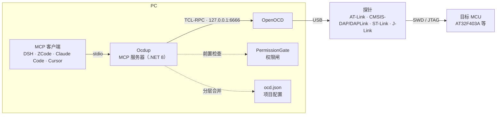

<div align="center">

# 🔧 Ocdup

**PC 侧的 OpenOCD 门面（MCP 服务器）**

让 MCP 客户端（DSH / ZCode / Claude Code / Cursor…）用自然语言驱动硬件调试器：
**连接探针 → 烧录固件 → 读写内存 → 执行控制**，全程无需手敲 TCL。

[](https://github.com/wenliang9527/ocdup/actions/workflows/ci.yml)
[](docs/design-plan.md)
[](plugins/ocdup-zcode/README.md)

</div>

---

## 💡 它能做什么

把调试器变成 AI 的「手」：你说目标，Ocdup 把它翻译成 OpenOCD 的 TCL 命令，
再把结果带上上下文整理成人话返回。典型场景：

| 你说 | AI 实际调用 | 说明 |
|---|---|---|
| 「把 build/fw.hex 烧进板子，烧完跑起来」 | `connect` → `flash_info` → `flash_write` | 自动擦写 + 校验（Verified OK）+ 复位运行 |
| 「板子里现在跑的是什么固件？」 | `verify_image` | 只读比对镜像与 flash 内容，不写任何东西 |
| 「读一下 0x20000000 处的 16 个字」 | `read_memory` | 8/16/32 位宽度；`format=json` 返回结构化值 |
| 「把整片 flash 备份下来」 | `dump_memory` | 大块落盘，返回路径 + 字节数 + sha256 |
| 「板子好像卡死了，看看现场」 | `halt` → 读写现场 → `reset run` | 执行控制；halt 后读写才可靠 |
| 「擦掉 0x080C0000 那个扇区」 | `flash_erase_sector` | 破坏性操作，默认关闭，显式开启才可用 |
| 「跑这条 TCL：`targets`」 | `run_command` | 原始命令逃生舱，兜底专用工具没覆盖的操作 |

## 🧰 工具一览（17 个）

### 会话与诊断

| 工具 | 作用 | 权限 |
|---|---|---|
| `connect` | 连接控制通道；无监听时按 ocd.json 自动拉起 OpenOCD（`interface_cfg: "auto"` 时先识别探针） | — |
| `status` | 后端是否运行、版本、target 列表（只读，不启动任何东西） | — |
| `show_config` | 有效设置与每项来源（`reload=true` 重读 ocd.json） | — |
| `backend_log` | ocdup 自己拉起的 openocd 近期 stdout/stderr（异步 `Info:` / `Error:` 日志从这里出） | 只读 |
| `identify_chip` | **连上后确认芯片**：读 CPUID（0xE000ED00，ARM 内核标准）+ 厂商 ID 寄存器（默认 0xE0042000），DEV_ID 按 ocd.json 的 `chip_id_map` 给出家族 | 只读 |
| `set_permissions` | **运行时改权限**（免改 ocd.json；闸 = ocd.json 的 `allow_set_permissions`，默认关；reload/重启丢弃） | 自身的授权闸 |

### 烧录

| 工具 | 作用 | 权限 |
|---|---|---|
| `flash_info` | 列出 flash banks（驱动、基址、大小） | 只读 |
| `flash_write` | **下载**：烧录镜像（写 + 可选校验 + 可选复位运行） | `read_only` / `allow_flash` / 白名单 / 上限 |
| `verify_image` | **烧后独立校验**：镜像与目标 flash 比对，不写任何东西（回答「板子里到底是谁」） | 只读 |
| `flash_erase_sector` | 擦除 flash 扇区（破坏性，默认关闭） | `read_only` / **`allow_flash_erase`（默认 false）** |

### 内存读写

| 工具 | 作用 | 权限 |
|---|---|---|
| `read_memory` | **读指定地址**：按 8/16/32 位宽度读回；`format=json` 返回结构化值（免解析 OpenOCD 文本） | 只读 + 体积上限 |
| `dump_memory` | **大块读落盘**：整片 flash / RAM 快照存成文件，返回 sha256 + 前 64 字节 | 目标侧只读；PC 侧落盘受 `dump_allowed_paths`（默认 `dumps/`）+ `dump_max_bytes`（默认 64 MB）约束 |
| `write_memory` | 写内存/寄存器（一条命令写多个值） | `read_only` / `allow_memory_write` |

### 执行控制与逃生舱

| 工具 | 作用 | 权限 |
|---|---|---|
| `halt` / `resume` / `reset` | 执行控制：halt 后读写才可靠；reset run 重启固件 | `read_only` / **`allow_exec`（默认 true）** |
| `run_command` | 原始 TCL 逃生舱（单行命令，兜底专用工具没覆盖的操作） | `read_only` / `allow_raw_command` |

> 后续里程碑：断点 / 观察点 / 符号层（按名读变量）/ L3 协议字典，见[设计文档第 12 节](docs/design-plan.md)。

## 🏗️ 架构



分层职责：**接入层**（MCP SDK，不含硬件逻辑）→ **工具层**（one tool = one capability）→
**控制层**（TCL-RPC 客户端 + 子进程生命周期）／**权限层**（变更类操作前置检查）／**配置层**（分层合并 + 来源追踪）。
设计细节见 [docs/design-plan.md](docs/design-plan.md)。

## 🚀 快速开始

### 1. 前置条件

- **.NET 8 SDK**（构建与运行 Ocdup）
- **OpenOCD**（提供探针驱动与 target 脚本），二选一：
  - `OCD_BIN` 指向 openocd 可执行文件、`OCD_SCRIPTS` 指向 scripts 目录；
  - 或把 openocd 放进 PATH。
- **探针**：`ocd.json` 的 `interface_cfg` 设 `"auto"` 时，连接阶段自动识别已插探针
  （AT-Link / CMSIS-DAP / ST-Link / J-Link，带 60s 进程内缓存）；也可显式写脚本名。

### 2. 构建

```bash
dotnet build Ocdup.sln
```

### 3. 配置

复制 `ocd.json.example` 为 `ocd.json` 放在项目根（或用 `OCD_CONFIG` 指向它），
换板子改 `target_cfg` 一行；权限按需收紧（见[权限与安全](#-权限与安全)）。

## 📱 客户端注册

> 路径说明：本文所有 `D:/path/to/...` 均为**占位符**，按本机实际位置替换
> （本机真实路径记录在 `LOCAL-MACHINE.md`，该文件已 gitignore、不入库）。

任何支持 stdio MCP 的客户端都可以注册：

```json
{
  "mcpServers": {
    "ocdup": {
      "command": "dotnet",
      "args": ["D:/path/to/Ocdup/publish/ocdup.dll"],
      "env": {
        "OCD_CONFIG": "D:/path/to/Ocdup/ocd.json",
        "OCD_BIN": "D:/path/to/openocd/bin/openocd.exe",
        "OCD_SCRIPTS": "D:/path/to/openocd/scripts"
      }
    }
  }
}
```

> `OCD_CONFIG` 省略时，Ocdup 按客户端进程的 CWD 找 `ocd.json`。

**通用纪律（所有客户端都适用）**：

- 注册一律指向 `publish/` 产物，**别指向 `bin/Debug`**——客户端是常驻进程，
  会锁住正在运行的 exe，导致开发时 `dotnet build` 报「文件被 ocdup 锁定」。
- **发布/升级顺序**：完全退出客户端 → `dotnet publish src/Ocdup/Ocdup.csproj -c Release -o publish` → 再启动客户端
  （或直接跑根目录的 `publish.cmd`，它带防锁检测）。
- **6666 端口单实例**：同一时间只能有一个 OpenOCD 后端；外部已开着 openocd 时
  Ocdup 直接复用。多个客户端（如 DSH + ZCode）共享同一后端，**不要两边同时烧录**。

<details>
<summary><b>在 DSH 中注册</b>（cordis.patch.yml）</summary>

往 `~/.dsh/profiles/<web|desktop>/cordis.patch.yml` 追加一个
`@deepseek-ai/dsh-mcp-client` 插件条目，完全退出并重启 DSH 后，工具以
`mcp__ocdup__<tool>` 出现在所有会话：

```yaml
- insert:
    - id: mcp-ocdup
      name: '@deepseek-ai/dsh-mcp-client'
      config:
        serverName: ocdup
        transport: stdio
        command: D:/path/to/Ocdup/publish/ocdup.exe
        args: []
        env:                       # DSH 不透传宿主 env，路径要显式给
          OCD_CONFIG: D:/path/to/Ocdup/ocd.json
          OCD_BIN: D:/path/to/openocd/bin/openocd.exe
          OCD_SCRIPTS: D:/path/to/openocd/scripts
```

> 卸载：删除该 insert 块并重启 DSH。

</details>

<details>
<summary><b>在 ZCode 中注册</b>（config.json + 可选插件）</summary>

编辑 `~/.zcode/cli/config.json`，在 `mcp.servers` 里加入：

```json
"ocdup": {
  "enabled": true,
  "command": "D:\\path\\to\\Ocdup\\publish\\ocdup.exe",
  "args": [],
  "env": {
    "OCD_CONFIG": "D:\\path\\to\\Ocdup\\ocd.json",
    "OCD_BIN": "D:\\path\\to\\openocd\\bin\\openocd.exe",
    "OCD_SCRIPTS": "D:\\path\\to\\openocd\\scripts"
  },
  "type": "stdio"
}
```

完全退出并重启 ZCode 后，工具以 `mcp__ocdup__<tool>` 出现在所有会话。

仓库还带 ZCode 插件 `plugins/ocdup-zcode`（ocdup-flash skill +
`/ocdup-status`、`/ocdup-flash` 命令，纯知识层、不含 MCP server）：在 ZCode →
Settings → Plugin Management → Discover → `+` 添加本仓库的 `plugins/` 目录并
安装即可，详见 [plugins/ocdup-zcode/README.md](plugins/ocdup-zcode/README.md)。

</details>

## 📖 使用示例

注册好之后，直接用自然语言下指令即可（AI 会自动选工具与参数）。等价的手动工具序列：

**烧录 → 校验 → 复位运行 → 读向量表**

```text
connect
flash_info
flash_write file=build/fw.bin address=0x08000000    # .elf/.hex 不需要 address
read_memory address=0x08000000 count=16 width=32 format=json
```

**整片 flash 快照**（绕开 read_memory 的 4KB 文本上限）

```text
connect
dump_memory file=dumps/flash.bin address=0x08000000 length=1048576
```

**卡死排查**

```text
halt
read_memory ...        # 看现场
resume                 # 或 reset run 重启固件
```

**烧后独立校验**（不写任何东西）

```text
verify_image file=build/fw.bin
```

**权限被拦时**：返回形如 `BLOCKED: 'flash_write' is not permitted ... See show_config.`——
若 ocd.json 里开了 `allow_set_permissions`，直接对话式调整（`set_permissions` 运行时生效，
reload/重启丢弃）；否则 `show_config` 核对生效权限，改 ocd.json 的 `permissions` 块并
`show_config reload=true`。拦截是设计行为，不要绕过。

## 🔒 权限与安全

| 权限项 | 默认 | 闸住的操作 |
|---|---|---|
| `read_only` | false | 总闸：以下全部 |
| `allow_flash` | true | `flash_write` |
| `allow_memory_write` | true | `write_memory` |
| `allow_flash_erase` | **false** | `flash_erase_sector`（破坏性，显式开启） |
| `allow_exec` | true | `halt` / `resume` / `reset` |
| `allow_raw_command` | true | `run_command` |
| `allow_set_permissions` | **false** | `set_permissions`（运行时改权限）——人类授权开关：放宽权限的决定权在人 |
| `flash_allowed_paths` | []（不限） | 烧录文件必须在白名单目录内 |
| `flash_max_bytes` | 0（不限） | 超大烧录文件拒绝 |
| `dump_allowed_paths` | `dumps/` | dump 落盘目标白名单 |
| `dump_max_bytes` | 64 MB | dump 大小上限（0 = 不限） |
| `memory_read_max_bytes` | 4096 | 单次读回体积上限（防呆） |

所有设置写进 `ocd.json` 的 `permissions` 块（或顶层平铺同名字段），改完
`show_config reload=true` 立即生效；`show_config` 同时显示每项的来源。

## 🧪 开发与测试

```bash
dotnet test Ocdup.sln                     # 110 个单测，不需要硬件
python tools/e2e_fake_backend.py          # 端到端：假 TCL-RPC 后端 + 真实 MCP 会话
```

- `tools/e2e_fake_backend.py` 启动一个假 TCL-RPC 后端（模拟 6666 端口）与真实
  MCP stdio 会话，覆盖工具注册、烧录/读内存/落盘链路、权限拦截文案、后端启动
  失败诊断——**没有硬件也能回归**。可用 `OCDUP_DLL=<path>` 指向任意构建产物。
- **流量镜像**：每次工具调用的 TCL 命令/响应、后端生命周期事件追加到
  `%LOCALAPPDATA%\Ocdup\mcp-traffic.jsonl`（超 2 MB 轮转）；openocd 自己的
  异步日志（`Info:`/`Error:`/target 事件）也逐行镜像（`direction: "log"`）。
  不接 UI 就能排障（直接 grep）。
- **DSH 侧边栏面板**：[tools/dsh-ocdup-panel/](tools/dsh-ocdup-panel/)
  （`deploy.cmd web` 部署 + 重启 DSH），右侧停靠栏实时显示命令/响应/日志/后端
  事件，五向过滤、目标过滤、正则搜索、导出 JSONL。零依赖行为测试
  `node test.js core|window|api|client`（71 项断言）；改代码只改真源目录再 `deploy.cmd`。
- **发布**：根目录 `publish.cmd`（单测 Release → publish → 提示重启 DSH；检测到
  ocdup.exe 在跑会拒绝执行）。CI：`.github/workflows/ci.yml`（build + 单测 + e2e）。
- 若客户端正在运行 ocdup 锁住了 `bin/Debug` 的 exe，测试改用 Release 通道：
  `dotnet test Ocdup.sln -c Release`。

## 📍 项目状态

| 里程碑 | 状态 |
|---|---|
| S1 骨架 / S2 控制层 / S3 烧录与读内存 | ✅ 110 个单测 + 假后端 e2e 覆盖 |
| S4 真机联调 | ✅ AT32F403AVGT7 + CMSIS-DAP v2（DAPLink `0D28:0204`）+ atopenocd：`connect` → `flash_info` → `flash_write`（擦 25 扇区、写 + Verified OK、reset run）→ `read_memory` 运行态读回向量表 |
| S5 打包与客户端注册 | 🟡 已注册进 DSH（desktop + web 两个 profile）与 ZCode（`mcp.servers` 条目 + `ocdup-zcode` 插件，均指 `publish/ocdup.exe`） |

后续里程碑（断点/观察点、符号层 L1/L2、L3 协议字典、与 acccom 的串口协同等）见
[设计文档第 12 节](docs/design-plan.md)。
